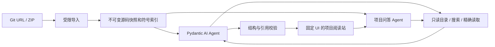

# 技术方案与开源调研

## 决策

| 技术 | 用途与理由 | 取舍 |
| --- | --- | --- |
| FastAPI | 上传、结果、问答和 SSE 接口；复用成熟 HTTP/校验机制 | 单进程部署，不引入分布式任务系统 |
| Pydantic AI slim + 官方 Harness + OpenAI provider | 已有的 Agent 工具循环、schema 输出、输出纠错、调用预算；兼容模型集中配置 | 模型须支持 Chat Completions 工具调用及结构化输出工具 |
| Python AST / Tree-sitter | Python、JS/TS/Java 的符号区间，避免正则猜括号 | 其他语言仅文件级分析 |
| 原生 ES modules / CSS / SVG | 固定 UI，可直接部署，同服务无需前端构建；SVG 架构图可关联源码 | 需自行维护较小的交互层 |
| SQLite + JSON + 源码快照 | 单机任务历史、事件重放、结果版本固定 | 不支持多 worker / 多副本；两个任务执行线程 |

## 调研来源与复用结论

- [DeepWiki Open](https://github.com/AsyncFuncAI/deepwiki-open)：仓库与 MIT 许可证已查看，可作为完整 Wiki 产品候选。本版的核心是功能链路代码阅读，已有原型；不直接引入完整产品及其检索部署栈。未克隆运行或声称验证其部署性能。
- [Pydantic AI 源码与文档](https://github.com/pydantic/pydantic-ai)：复用 `Agent`、工具注册、`output_validator` / `ModelRetry` 和 `UsageLimits`。验证使用框架 `FunctionModel` 与兼容 HTTP provider 集成，不实现自有 ReAct 循环。
- [FastAPI 文件上传](https://fastapi.tiangolo.com/tutorial/request-files/) / [后台任务](https://fastapi.tiangolo.com/tutorial/background-tasks/)：复用 UploadFile；本版以有界线程池运行长任务，状态与事件持久化，重启显式失败。
- [Tree-sitter Python bindings](https://github.com/tree-sitter/py-tree-sitter)：MIT，复用 JS/TS/Java parser 定位节点起止行；已安装版本通过语言样例验证。

## 数据流

持久化事件包括阶段、阶段进度、时间和工具操作摘要；不记录隐藏推理。进度不是虚构的 token 百分比，Agent 阶段按工具操作逐步推进并封顶。完成后写入结果，最后发布 100%。

源码从不执行。ZIP 检查路径穿越、符号链接及展开大小；Git 限制 HTTPS、允许主机、公开 IP、禁用重定向和凭据提示，固定提交并去掉 .git。所有索引与工具操作仅访问内存快照。敏感文件名排除不等于完整密钥扫描，导入前仍需移除源码内嵌凭据。

结果知识来源于同一快照，问答也使用此快照。引用校验保证“文件存在、区间有效、模型确实读取”，不能证明模型解释或架构连线语义绝对正确。跨文件符号同名搜索明确标记为线索。

## 扩展点

新增语言：在 `analysis/index.py` 注册后缀及解析器。新增源码工具：在 `analysis/agent.py` 用 `@agent.tool` 注册并通过 `RepositoryContext` 访问快照。新增输出内容：更新 `analysis/schemas.py`、引用校验及相应前端模块。

## 上下文与分批结果

结果采用 Pydantic AI 的 `save_feature`、`save_node`、`save_edge` 工具逐条校验并持久化；最终输出类型仅包含概述、阅读建议和边界，服务端装配成既有结果结构。检查点 v2 保存已完成记录，旧版本消息迁移时移除失效的整份输出调用，保留读取工具的配对记录。

通过框架 [Capability](https://github.com/pydantic/pydantic-ai) 管理每次请求的上下文预算；分词复用 [tiktoken](https://github.com/openai/tiktoken)，未知兼容模型的计数为估算。框架继续负责 Agent 循环、工具调用、重试及结构化输出；项目只提供预算策略和领域工具。

工具参数兼容通过 Pydantic AI 的 `before_tool_validate`、`after_tool_validate` 和错误钩子实现；JSON 语法解析修复复用 [json-repair](https://github.com/mangiucugna/json_repair)，不实现自有解析器或 Agent 循环。schema 不匹配及模糊的复合损坏由模型重新生成，所有记录仍通过源码证据校验后才落盘。

仓库级执行采用 [模块阶段与官方 Harness](harness.md)，分别保存模块摘要、计划和工作记忆；每个模块与最终汇总各用独立历史，取消和恢复沿用当前任务状态机。
